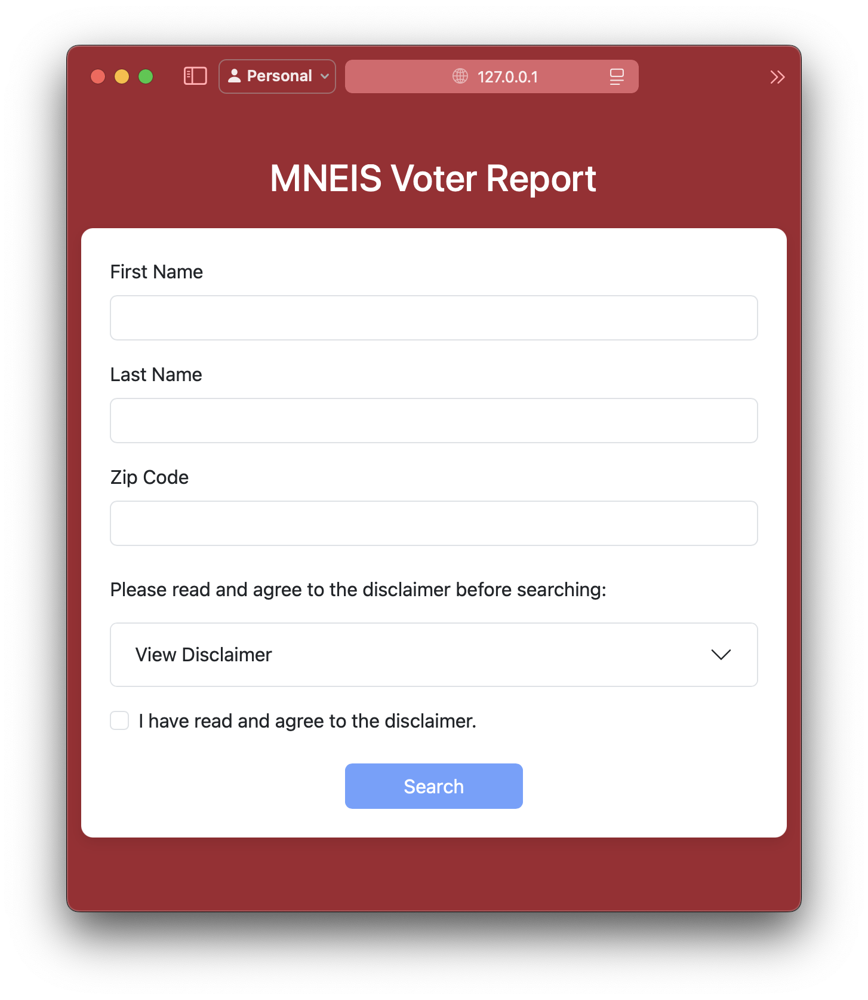

# MNEIS Voter Report Project

Welcome to the Minnesota Election Integrity Solutions (MNEIS) Voter Report project! This tool allows Minnesota citizens to verify their voter registration information and election history using publicly available data from the Minnesota Secretary of State. The project aims to enhance election integrity by enabling individuals to ensure the accuracy of their voter records. This project contains various elements which might be useful for others working with the MN OSS public voter data. 

## Overview

The goal of this project is to provide a web-based application designed to provide Minnesota voters with access to their voter registration details and election participation history. The system uses a SQLite database populated with voter and election data, a Flask server for the middleware (if wanting to use a browser frontend), and Python scripts to process and query the data. Users can input their first name, last name, and zip code to retrieve a personalized report.

The project emphasizes transparency, privacy, and compliance with Minnesota Statutes Chapter 13, ensuring that all data usage aligns with legal requirements and prioritizes user consent.

The project aims to expand in the future to provide additional useful data analysis tooling to analyze and report on data quality issues and compliance topics as related to Minnesota Statue for voter data. For example, in the future the ability to quickly and easily search on duplicate data, voters that are missing data, voters who are active but should not be, etc. 

## Features

- Importing to a modern database: Python3 script which can import the provided MN OSS voter history data into a sqlite database (making data querying fast and easy).
- Voter Information Lookup: Search for voter records by first name, last name, and zip code.
- Election History: View a detailed history of elections in which the voter participated, including dates, descriptions, and voting methods.
- Data Validation: Client-side validation ensures accurate input (e.g., valid Minnesota zip codes between 55001 and 56763).
- Responsive Design: Built with Bootstrap for a user-friendly experience across devices.
- Command-Line Alternative: Scripts are available for generating reports directly from the terminal.

This Python script `import_to_sqlite3.py` creates a SQLite database (`voters.db`) and imports voter registration and election history data from a set of CSV files (`Voter01.txt` to `Voter08.txt` and `Election01.txt` to `Election08.txt`). It processes the files, handles encoding detection, and logs errors, providing a summary of total and imported rows for both voter and election data. The CSV files are part of the data set as obtained from the Minnesota OSS when requesting a full voter history data set for $46 as a Minnesota resident. 

## Technical Details for `import_to_sqlite3.py`
- Using python, creates a local sqlite database, with two tables:
  - `voters`: Stores voter registration details (e.g., `VoterId`, `FirstName`, `LastName`, `City`, `State`, `DOBYear`, etc.).
  - `election_history`: Stores voting history (e.g., `VoterId`, `ElectionDate`, `ElectionDescription`, `VotingMethod`).
- Accepts an original `WO*.zip` from the Secretary of State or a directory of quoted `VoterNN.txt` / `ElectionNN.txt` files. The zip is read in place; no extraction is required.
- Detects encoding per file incrementally: UTF-8-sig is used when valid, otherwise falls back to Windows-1252 for districts with ½ and similar characters. No external `chardet` dependency.
- Handles quoted CSV correctly – quotes are syntax, not data. Do **not** strip quotes from files before import.
- Uses batch `executemany` inserts with BATCH_SIZE=50,000 and builds indexes after load for speed.
- Includes error handling for malformed rows and provides a detailed error log with up to 100 samples.
- Adds indexes on `FirstName`, `LastName`, `ZipCode`, and `VoterId` for efficient querying.
- Normalizes dates to `YYYY-MM-DD` format with an LRU-cached fast path.
- Prints a summary of total rows vs. imported rows, with warnings for discrepancies, and reports progress every 500,000 rows.

## Prerequisites for use of `import_to_sqlite3.py`
- A computer with internet access and at least 4GB of free space.
- Python 3 installed (see installation steps below if you don’t have it).
- Required Python libraries: `sqlite3` (built-in), `csv` (built-in), `os` (built-in), `sys` (built-in), `datetime` (built-in). No external encoding library is required.

## Installation

### Step 1: Install Python
If you don’t have Python installed, follow these steps based on your operating system:

#### macOS
1. **Check if Python is Installed**:
   - Open Terminal (Applications > Utilities > Terminal).
   - Run: `python3 --version`
   - If you see a version (e.g., `Python 3.9.6`), skip to Step 2. Otherwise, proceed.
2. **Install Homebrew (if not installed)**:
   - Run: `/bin/bash -c "$(curl -fsSL https://raw.githubusercontent.com/Homebrew/install/HEAD/install.sh)"`
   - Follow the prompts to install.
3. **Install Python**:
   - Run: `brew install python`
   - Verify: `python3 --version`

#### Windows
1. **Download Python**:
   - Visit [python.org/downloads](https://www.python.org/downloads/).
   - Download the latest Python 3 installer (e.g., Python 3.11.x).
2. **Run the Installer**:
   - Double-click the downloaded file.
   - Check "Add Python to PATH" at the bottom of the installer window.
   - Click "Install Now" and follow the prompts.
3. **Verify Installation**:
   - Open Command Prompt (search "cmd" in Start menu).
   - Run: `python --version`
   - You should see the version number.

#### Linux (Ubuntu/Debian)
1. **Update Package List**:
   - Open a terminal.
   - Run: `sudo apt update`
2. **Install Python**:
   - Run: `sudo apt install python3 python3-pip`
   - Verify: `python3 --version`

### Step 2: Install Dependencies
No external dependencies are required for `import_to_sqlite3.py`. The script uses only Python standard library modules. Standard library modules `sqlite3`, `csv`, `os`, `sys`, `datetime`, `argparse`, `zipfile`, `io`, `codecs`, `sqlite3` are built-in.

If you plan to use the web interface, install Flask and Tabulate as described below.

## Usage

1. **Prepare Your Input Files**:
   - The script accepts an original `WO*.zip` from the Secretary of State or a directory containing quoted `VoterNN.txt` and `ElectionNN.txt` files.
   - If using a zip, keep the original quoted files inside the zip. Do **not** strip quotes from the files before import.
   - Voter files: `VoterNN.txt` (CSV format, 38 columns).
   - Election files: `ElectionNN.txt` (CSV format, 4 columns).
   - **Voter File Format** (38 columns, with headers):
     ```
     VoterId,CountyCode,FirstName,MiddleName,LastName,NameSuffix,HouseNumber,StreetName,UnitType,UnitNumber,Address2,City,State,ZipCode,MailAddress,MailCity,MailState,MailZipCode,PhoneNumber,RegistrationDate,DOBYear,StateMcdCode,McdName,PrecinctCode,PrecinctName,WardCode,School,SchSub,Judicial,Legislative,StateSen,Congressional,Commissioner,Park,SoilWater,Hospital,LegacyId,PermanentAbsentee
     ```
   - **Election File Format** (4 columns, with headers):
     ```
     VoterId,ElectionDate,ElectionDescription,VotingMethod
     ```
   - Example `Voter01.txt`:
     ```
     VoterId,CountyCode,FirstName,MiddleName,LastName,NameSuffix,HouseNumber,StreetName,UnitType,UnitNumber,Address2,City,State,ZipCode,MailAddress,MailCity,MailState,MailZipCode,PhoneNumber,RegistrationDate,DOBYear,StateMcdCode,McdName,PrecinctCode,PrecinctName,WardCode,School,SchSub,Judicial,Legislative,StateSen,Congressional,Commissioner,Park,SoilWater,Hospital,LegacyId,PermanentAbsentee
     12345,HOU,John,A,Doe,,123,Main St,APT,4,,Houston,MN,55943,PO Box 123,Houston,MN,55943,555-1234,2020-01-15,1980,001,Houston City,001,Precinct 1,01,Houston ISD,01,01,01,01,01,01,01,01,,Y
     ```
   - Example `Election01.txt`:
     ```
     VoterId,ElectionDate,ElectionDescription,VotingMethod
     12345,11/03/2020,General Election,In-Person
     ```

2. **Run the Script**:
   - Open a terminal in the directory containing the script and input files.
   - Run with a zip:
     ```bash
     python3 import_to_sqlite3.py /path/to/WO261108.zip
     ```
   - Or specify output:
     ```bash
     python3 import_to_sqlite3.py -o custom.db /path/to/WO261108.zip
     ```
   - Or use a directory of original quoted files:
     ```bash
     python3 import_to_sqlite3.py /path/to/unzipped_folder
     ```
   - If no source is provided, the script searches for a single `WO*.zip` in the current directory, script directory, or parent directory.
   - The database is auto-named `<zipname>.db` or `voters.db` in the source directory. Use `-o` to override.

3. **Output**:
   - Creates `voters.db` with two tables: `voters` and `election_history`.
   - Prints processing details, including:
     - Number of rows processed per file.
     - Total rows vs. imported rows for voters and elections.
     - Warnings for missing files or row discrepancies.
     - Error log for malformed rows (first 10 errors shown).
   - Example output:
```
Files:    8 voter, 8 election

→ Voter01.txt (encoding: utf-8-sig)
   472,011 voters

→ Voter02.txt (encoding: utf-8-sig)
   500,000 rows read
   518,294 voters (1 duplicate VoterIds ignored)

...

→ Voter07.txt (encoding: cp1252)
   485,192 voters (1 duplicate VoterIds ignored)

→ Voter08.txt (encoding: utf-8-sig)
   500,000 rows read
   515,708 voters (1 duplicate VoterIds ignored)

Election history

→ Election01.txt (encoding: utf-8-sig)
   500,000 rows read
   1,000,000 rows read
   1,500,000 rows read
   2,000,000 rows read
   2,500,000 rows read
   3,000,000 rows read
   3,500,000 rows read
   4,000,000 rows read
   4,500,000 rows read
   5,000,000 rows read
   5,500,000 rows read
   5,509,828 election rows

...

→ Election08.txt (encoding: utf-8-sig)
   500,000 rows read
   1,000,000 rows read
   1,500,000 rows read
   2,000,000 rows read
   2,500,000 rows read
   3,000,000 rows read
   3,500,000 rows read
   4,000,000 rows read
   4,500,000 rows read
   5,000,000 rows read
   5,500,000 rows read
   6,000,000 rows read
   6,500,000 rows read
   6,850,126 election rows

Building search indexes...
============================================================
IMPORT COMPLETED SUCCESSFULLY
Database                  : WO261108.db
Voters imported           : 3,931,627
Election rows imported    : 46,790,870
```

## Notes
- **File Requirements**: The script expects `VoterNN.txt` and `ElectionNN.txt` files with quoted CSV. Missing files are skipped with a warning.
- **Encoding**: Each file is decoded incrementally as UTF-8-sig or Windows-1252. Do not pre-process files to remove quotes.
- **Error Handling**: Rows with incorrect field counts or unparseable data (e.g., invalid dates, non-integer `VoterId`) are logged and skipped. Up to 100 error samples are kept.
- **Date Parsing**: Supports formats like `MM/DD/YYYY`, `YYYY-MM-DD HH:MM:SS`, and normalizes to `YYYY-MM-DD`.
- **Performance**: Indexes are built after load; PRAGMAs are tuned for bulk loading. BATCH_SIZE=50,000 rows per transaction.
- **Customization**: Use `-o` to specify a custom database name. The build is atomic via a temporary `.building` file.
- **Import Time**: On an M4 Mac mini 64GB, the import time is just a few minutes. Your importing time may vary. 

## Technical Details for ## Technical Details for `voter_election_report_printf.py`
- Using `voter_election_report_printf.py`, you can use your Terminal (Command Prompt) to directly query the resulting sqlite database (`voters.db`). 
- Example: Run the report script with arguments: `python3 voter_election_report_printf.py --first-name "John" --last-name "Doe" --zip-code "55101"`
- Output will display voter information and election history in a tabulated format.

```
+----------+------------+-------------+-----------+----------+------------------+------------+----------+-------+
| Voter ID | First Name | Middle Name | Last Name | Zip Code | Registration Date | Birth Year | City     | State |
+----------+------------+-------------+-----------+----------+------------------+------------+----------+-------+
| 123456   | John       | A           | Doe       | 55101    | 2020-01-15       | 1980       | St. Paul | MN    |
+----------+------------+-------------+-----------+----------+------------------+------------+----------+-------+
+---------------------------------------------------------------+
| --------------------- Voter Election History ----------------- |
+---------------------------------------------------------------+
+----------+-----------------+-------------------------+--------------+
| Voter ID | Election Date   | Election Description    | Voting Method |
+----------+-----------------+-------------------------+--------------+
| 123456   | 2022-11-08      | State General Election  | P            |
| 123456   | 2020-11-03      | State General Election  | A            |
+----------+-----------------+-------------------------+--------------+
```


## Technical Details for `voter_election_report.py`
- Core logic for querying the database and returning voter reports as a dictionary (used by the web app).

## Technical Details for `app.py`
- Flask application to serve the web interface.

### Requirements for use via web browser
- Python 3.7+
- SQLite3
- Flask (`pip install flask`)
- Tabulate (`pip install tabulate`) - for command-line reporting
- Web Browser (e.g., Safari, Chrome, Firefox) for the web interface

### Installation for use via web browser
- Ensure you have generated the required `voters.db`
- Ensure you have installed the required dependencies for `flask` and `tabulate`
- With the `voters.db` and `app.py` and `index.html` in the same directory, execute `phthon3 app.py`. This starts the Flask server, on port 5000.
- Open a browser and navigate to `http://127.0.0.1:5000`. You should see a nice HTML page you can use to look up voter information.



## Technical Details for `readme.txt`
- Documentation from the Minnesota Secretary of State about voter file formats and abbreviations.

## Technical Details for `index.html`
- HTML template for the web interface, styled with Bootstrap. Handles form input and displays results.


## Contributing
Feel free to fork this repository, submit issues, or create pull requests with enhancements (e.g., additional file support, custom date formats).

## License
This project is unlicensed and provided as-is for personal use. No warranty is implied.
